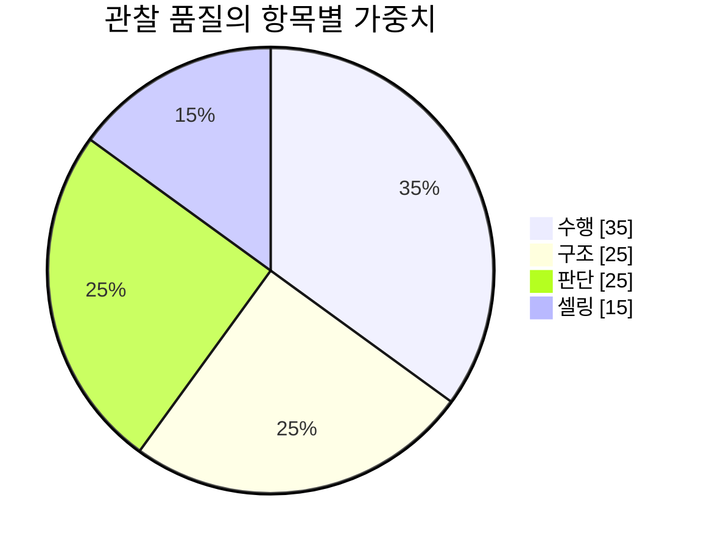
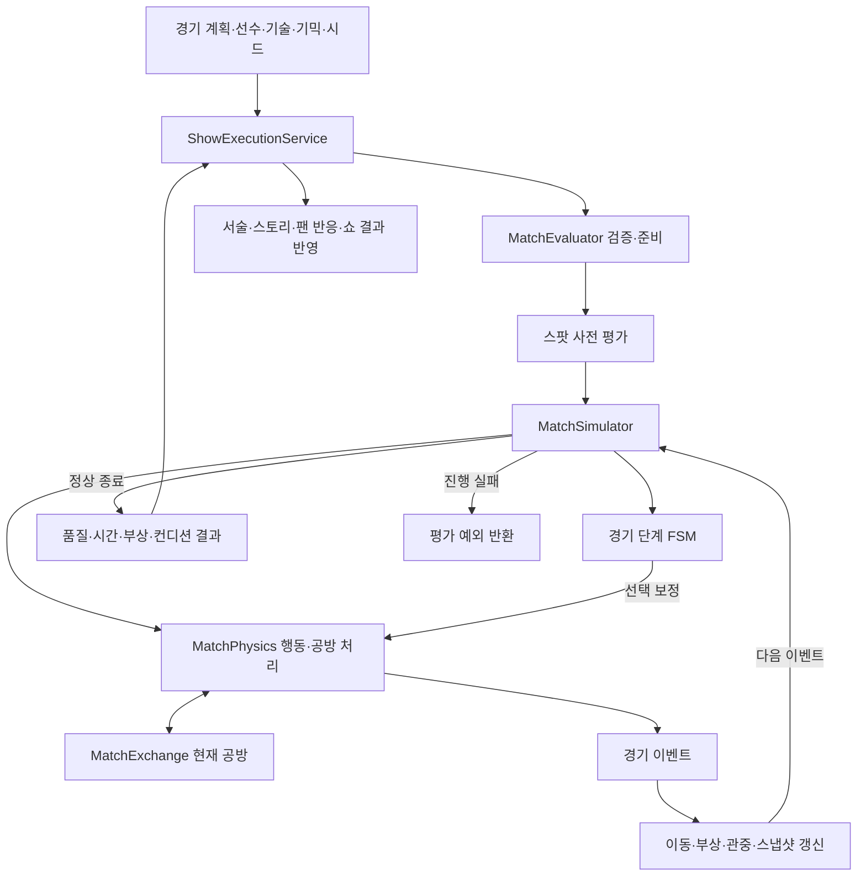
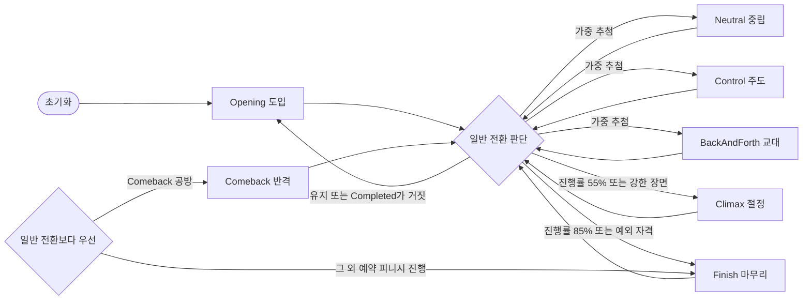
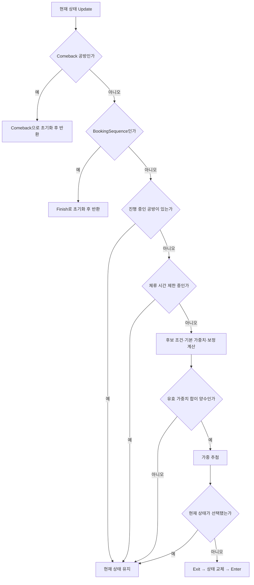
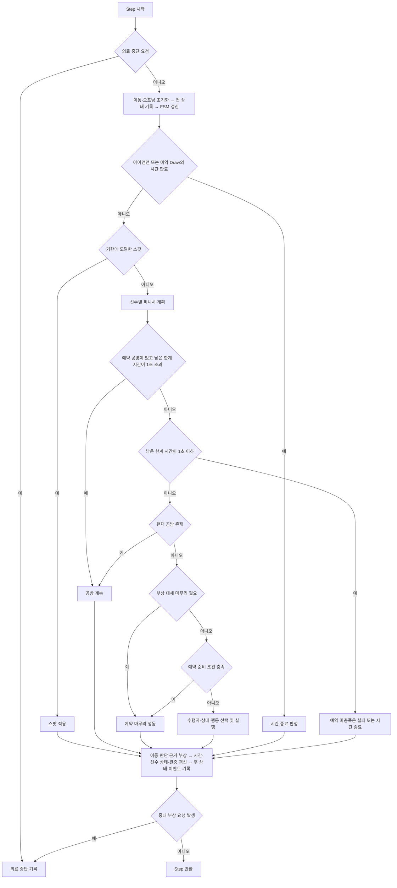
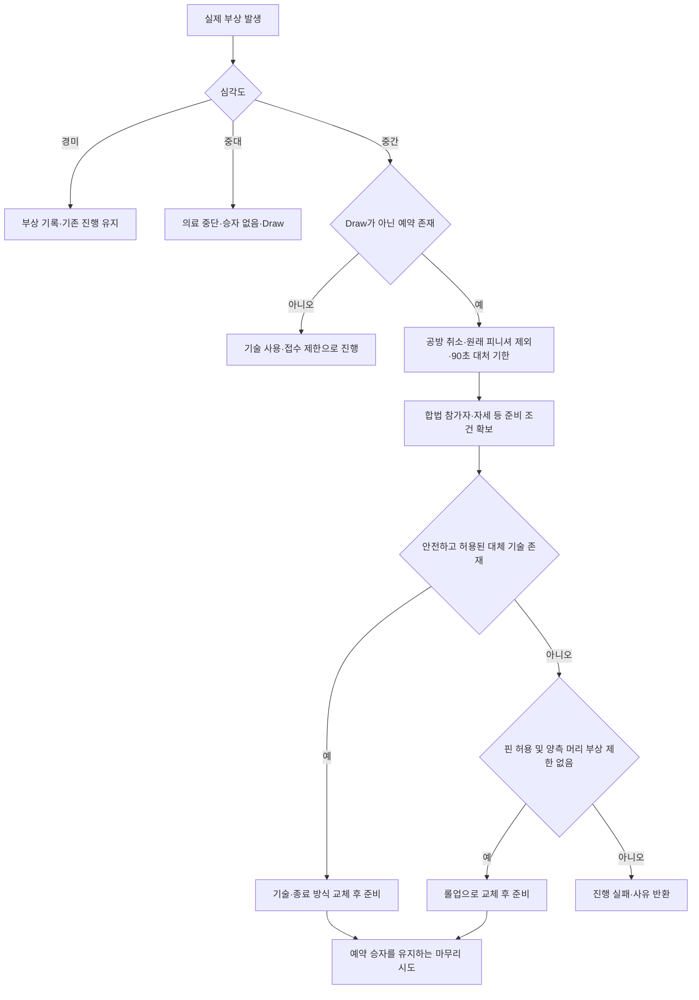
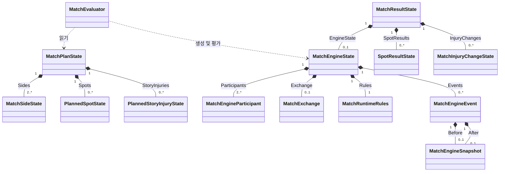

# PWMANAGER 매치엔진 시스템 기획서

| 기준 | 내용 |
| --- | --- |
| 문서 버전 | 0.2, 표·도식 중심 개정 |
| 기준일·구현 | 2026-10-14 / MatchSimulator EngineVersion 4 |
| 문서 성격 | 현재 구현 명세. 한국어 상태명과 목적은 동작에 대한 해석 |
| 확인 범위 | 소스 대조. Unity 실행 검증 결과는 아님 |

## 1. 시스템 정의

### 1.1 시스템 개요

**경기 계획과 선수 정보로 경기 과정을 생성하고, 실제 결과와 후속 변화를 산출한다.**

| 구분 | 내용 |
| --- | --- |
| 입력 | 경기 계획, 목표 시간, 선수 능력·스타일·컨디션·기술, 유형·기믹, 스팟, 시드 |
| 처리 | 계획 검증 → 초기화 → 이벤트 생성 → 종료 판정 → 경기 평가 |
| 출력 | 실제 승패·시간·종료 유형, 이벤트·스냅샷, 품질, 부상·컨디션 변화 |
| 상위 연결 | 쇼 실행, 스토리·팬 반응, 경기 서술·재생, 결과 반영 |

**예약 결과는 진행 목표다. 실제 부상·규칙 제약은 변경 또는 실패를 일으킬 수 있다.** 입력 필드가 모두 플레이어 화면에 노출된다는 뜻은 아니다.

### 1.2 구성 요소와 책임

| 영역 | 구현 | 책임 | 다음 연결 |
| --- | --- | --- | --- |
| 쇼 실행 | ShowExecutionService | 타임라인 실행, 서술·후속 시스템 연결 | MatchEvaluator |
| 준비·평가 | MatchEvaluator | 계획 검증, 선수·규칙 생성, 결과·품질 계산 | MatchSimulator |
| 반복 진행 | MatchSimulator | 초기화, 이벤트 단위 Step | FSM·MatchPhysics |
| 경기 단계 | MatchStateMachine | 현재 단계·전환·선택 보정 | 행동·수행자 점수 |
| 세부 공방 | MatchPhysics / MatchExchange | 기술·홀드·카운트·연속 공방 | 경기 이벤트 |
| 행동 선택 | PerformerSelector / TargetSelector / ActionEvaluator / ActionSelector | 후보 점수와 선택 | MatchPhysics 실행 |
| 상태 기록 | MatchMovement / MatchHealth | 이동·부상·판단·셀링 근거 | 상태·이벤트·평가 |

진행 단위는 **소요 시간이 서로 다른 이벤트**다. 고정 시간 간격의 갱신으로 설명하지 않는다.

### 1.3 경기 단계 FSM

**가중 확률로 전환하는 경기 단계 FSM**이다. 유한한 7개 상태, CurrentState, 전환 후보와 Enter·Update·Exit 인터페이스를 갖는다.

| 구분 | 현재 구조 | 문서에서의 해석 |
| --- | --- | --- |
| 단계 관리 | FSM | 경기의 큰 흐름 |
| 다음 단계 | 조건·가중치 기반 추첨 | 정해진 순서로 통과하지 않음 |
| 현재 공방 | MatchExchange | 세부 진행 맥락. 별도 계층형 FSM으로 단정하지 않음 |
| 행동 결정 | 점수 기반 선택 + 우선 처리 | 전체 매치엔진을 FSM 하나로 부르지 않음 |

#### 상태별 역할

| 상태 | 한국어명 | 역할 | 수행자 점수 보정 |
| --- | --- | --- | --- |
| Opening | 도입 | 오프닝 스타일에 맞는 공방 | 오프닝 우세 진영 보정은 별도 로직 |
| Neutral | 중립 | 주도권 균형 | `(50-주도권)×0.08` |
| Control | 주도 | 우세 선수 진행 | 전체 참가자 중 최대 주도권 이상이면 +12 |
| Comeback | 반격 | 밀리던 선수의 반격 | 최저 주도권 +22, 최근 3개 이벤트 피해자 +14, 준비도×0.08 |
| BackAndForth | 공방 교대 | 수행자 교대 | 최근 2개 이벤트 수행자 -18, 나머지 +8 |
| Climax | 절정 | 주요 기술·위기 집중 | 기본 +0 |
| Finish | 마무리 | 피니시 행동 집중 | 기본 +0 |

최대·최저 주도권 비교의 대상은 **전체 참가자**다. Finish 진입은 종료 완료가 아니며 실제 종료는 IsFinished로 구분한다.

#### 상태별 행동 배율

| 상태·스타일 | 행동 | 배율 |
| --- | --- | ---: |
| Opening, Probe/Automatic | Probe / TieUp | 2 / 4 |
| Opening, Probe/Automatic | Pin / Finisher / Signature | 0.2 / 0.025 / 0.08 |
| Opening, Probe/Automatic | HeavyStrike / Grapple / BasicStrike | 0.3 |
| Opening, 그 외 스타일 | Probe / TieUp / Pin / Signature | 0.08 / 0.08 / 0.2 / 1 |
| Opening, 그 외 스타일 | HeavyStrike / Grapple / BasicStrike | 2 |
| Opening, Ambush / 그 외 비Probe 스타일 | Finisher | 3 / 0.8 |
| Comeback | HeavyStrike·Signature / Rest | 1.55 / 0.55 |
| BackAndForth | HeavyStrike·Signature | 1.4 |
| Climax | Signature·Finisher·Pin·Submission | 1.65 |
| Finish | Finisher·Pin·Submission | 4 |
| Finish | Signature·HeavyStrike / 그 밖의 행동 | 1.8 / 0.65 |

표에 없는 배율은 ×1, 수행자 보정은 +0이다.

#### 전환 판단 우선순위

| 순서 | 검사 | 처리 |
| ---: | --- | --- |
| 1 | 현재 상태 | Update 호출 |
| 2 | Comeback 공방 | Comeback Initialize 후 반환 |
| 3 | BookingSequence | Finish Initialize 후 반환 |
| 4 | 그 밖의 공방 존재 | 유지 |
| 5 | Opening/Comeback 이외, 현재 단계 연속 이벤트 존재 | `clamp(목표 초/40,20,45)`초 미만 체류면 유지. 정수 나눗셈 |
| 6 | 후보 점수 | NaN·Infinity·0 이하는 0. 합이 0이면 유지 |
| 7 | 가중 추첨 | 현재 상태면 유지. 다른 상태면 Exit → 교체 → Enter |

**2·3의 Initialize는 이전 Exit를 호출하지 않는다.** 일반 전환으로 Opening을 떠날 때만 Exit가 Completed를 설정한다. Completed=true이면 Opening 후보 점수는 0이다.

#### 기본 전환 가중치 매트릭스

행은 현재 상태, 열은 후보 상태다. **확률이 아니라 보정 전 상대 가중치**다.

| 현재 ↓ / 후보 → | Opening | Neutral | Control | Comeback | BackAndForth | Climax | Finish |
| --- | ---: | ---: | ---: | ---: | ---: | ---: | ---: |
| Opening | 120 | 100 | 50 | 5 | 15 | 4 | 1 |
| Neutral | 12 | 105 | 55 | 8 | 40 | 8 | 1 |
| Control | 2 | 18 | 110 | 35 | 40 | 15 | 2 |
| Comeback | 1 | 8 | 55 | 65 | 80 | 28 | 3 |
| BackAndForth | 1 | 8 | 35 | 25 | 105 | 55 | 5 |
| Climax | 0.5 | 2 | 12 | 10 | 45 | 110 | 38 |
| Finish | 0.2 | 1 | 5 | 4 | 18 | 35 | 115 |

| 계산 단계 | 공식 |
| --- | --- |
| 후보 점수 | `max(0, 기본 가중치×전환 보정)` |
| 유효 가중치 | 비유한 값·0 이하 → 0 |
| 선택 확률 | 해당 유효 가중치 / 전체 유효 가중치 합 |

#### 후보 진입 조건

| 후보 | 자격 조건 | 주의 |
| --- | --- | --- |
| Opening | Completed=false | 완료 후 복귀 차단 |
| Comeback | Comeback 공방 | 우선 Initialize로 처리하므로 일반 추첨의 임의 진입 대상 아님 |
| Climax | 진행률≥55% **또는** 결정적 마지막 이벤트 **또는** 최근 6개 NearFall | 조건 충족은 진입 보장 아님 |
| Finish | 진행률≥85% **또는** 진행률≥65% 및 최근 6개 NearFall **또는** 우세 진영 지정·목표≤600초·결정적 마지막 이벤트 | 마지막 조건은 세 항목 모두 필요 |

결정적 마지막 이벤트: **Finisher 또는 Impact≥15**.

#### 전환 보정식

| 기호 | 의미 |
| --- | --- |
| p / F / C | `max(0, 경과 초/목표 초)` / 활동 중 선수 평균 피로 / 활동 중 선수 주도권 차 |
| I / H / D | 경기 강도 / 관중 열기 / 드라마 |
| N / n | 최근 6개에 NearFall이 있으면 1 / 현재 단계 연속 이벤트 수 |
| J / U | 결정적 마지막 이벤트면 1 / 최근 우세 공방이면 0.8, 아니면 0 |

| 적용 대상 | 곱하는 보정 |
| --- | --- |
| 현재 상태 | `1+min(1.5,n×0.18)` |
| Neutral·Control | `max(0.2,1.4-p)` |
| Control 추가 | `1+C/45` |
| Comeback | `1+C/35+F/100+U` |
| BackAndForth | `1+I/80+H/150+1.2N` |
| Climax | `0.35+p+D/80+H/120+2J` |
| Finish | `0.08+p²+F/120+5J+1.5N` |
| 최근 전환 과다, 다른 상태 후보 | 최근 8개 이벤트의 단계 변화≥3회이면 ×0.45 |

최근 우세 공방: 최근 6개 이벤트가 3개 이상이고, 같은 수행자 또는 피해자가 전체 중 1개를 제외한 수 이상을 차지한다. 해당하는 보정은 서로 곱한다.

### 1.4 오프닝 규칙

| 항목 | 규칙 |
| --- | --- |
| 스타일 | Automatic / Probe / Clash / Dominance / Ambush |
| Automatic | 적대감·진영 평균 지위 차·기습 성향으로 스타일 추첨 |
| 적대감 | 다른 진영 선수 관계값의 음수 크기 중 최대값 |
| 우세 진영 | 지위 차≥25이면 최고 지위 진영, 그 미만은 규칙의 우세 진영 |

| 이탈 검사 순서 | 조건 | 결과 |
| ---: | --- | --- |
| 1 | 초기화 전 / Chain 진행 중 | 허용 / 차단 |
| 2 | Finisher·Spot 또는 Impact≥9 이벤트 존재 | 허용 |
| 3 | 경과≥`max(6,min(120,목표 초/5))` | 허용 |
| 4 | Probe 이외, 경과≥10초 | 허용 |
| 5 | Probe: 경과≥`min(75,목표 초/10)`, 완료 체인≥1, 주도권 차≥8 | 모두 만족하면 허용 |

**이탈 허용은 즉시 전환을 뜻하지 않는다.**

### 1.5 행동 선택과 공방

| 단계 | 처리 | 영향 요소 |
| --- | --- | --- |
| 수행자 | 활동 중 선수 가중 선택 | 피로·주도권·준비도·최근 기록·FSM·오프닝 |
| 상대 | 합법 상대 후보 선택 | 상대 상태·최근 공방 |
| 행동 | 현재 실행 가능한 후보 생성·점수 계산 | 자세·위치·부상·기술·전술·반복·FSM |
| 공방 유지 | Exchange가 있으면 계속 진행 | 매 이벤트마다 새 기술을 추첨하지 않음 |

| 수행자 점수 항목 | 값 |
| --- | --- |
| 기본 | `20+주도권×0.55+준비도×0.75-피로×0.35` |
| 다운 | -45 |
| 최근 2개 이벤트 수행 | 일반 -18 / 우세 진영 -2 |
| 최근 3개 이벤트 피해 | Comeback +30 / 그 외 +10 |
| 추가·최솟값 | FSM·오프닝 보정 추가 후 최소 0.01 |

| 공방 종류 | 값 |
| --- | --- |
| 기술·카운트 | FollowUp, Cover, Hold, Counter, CountOut, GripCombo |
| 이동·준비 | Chain, RopeSequence, CornerSequence, Preparation, Transition |
| 특수 장면 | Object, Ringside, TopContest, DoubleDown, Comeback |

행동 결과(성공·실패·반격 등)와 경기 종료 유형은 별도다. 모든 행동이 모든 결과를 갖는 것은 아니다.

### 1.6 스팟 규칙

| 항목 | 규칙 |
| --- | --- |
| 계획 검증 | 사용 구간, 주체 범위, 피해자 참가 여부, 팀 관계 |
| 금지 | 동일 주체·피해자, PartnerId 지정 |
| 결과 생성 | 평가 단계에서 사전 추첨 후 엔진에 예약 |
| 반복 R | 당일 포함 이전 56일 기록 + 같은 쇼 대기 결과 + 현재 경기 앞선 동일 스팟 |

| 계산 | 공식 |
| --- | --- |
| 역할점수 | `max(0,(SpotWork×2+전문 능력 또는 셀링)/3-(100-컨디션)/20-부상 감점)` |
| 부상 감점 | 경미 1 / 중간 3 / 중대 6 |
| 유효 수행력 E | `(주체 역할점수×2+피해자 역할점수)/3` |
| 확률 변수 | `m=E-난도+1`, `C(b)=1/(1+exp(-(b-m)/1.5))` |

| 결과 | 확률 | 점수 배율 | 반복 보정 |
| --- | --- | ---: | --- |
| Disaster | `C(-4)` | -1.5 | `min(1.5,1+0.1R)` |
| Failure | `C(-1)-C(-4)` | -0.5 | `min(1.5,1+0.1R)` |
| Success | `C(3)-C(-1)` | 1 | `max(-0.5,1.1-0.2R)` |
| GreatSuccess | `1-C(3)` | 1.5 | `max(-0.5,1.1-0.2R)` |

Disaster는 두 선수 평균 즉흥 대처/20 확률로 Failure로 복구한다. 점수는 **기본점수×결과 배율×반복 보정**이다.

| 구간 | 경기 목표 시간 대비 적용 시점 | 비고 |
| --- | ---: | --- |
| Entrance | 0% | 입장 중단은 경기 시뮬레이션 생략 가능 |
| Early | 20% | 도달 후 이벤트 선택에서 적용 |
| Middle | 50% | 도달 후 이벤트 선택에서 적용 |
| Late | 80% | 도달 후 이벤트 선택에서 적용 |
| PostMatch | 경기 중 적용 제외 | 이 적용 함수의 대상 아님 |

스팟은 한 번에 하나씩 적용하며 공방을 끊는다. **중단·실격의 ScriptedEffect는 수행 성공 여부와 별도**로 처리한다.

### 1.7 종료·시간 규칙

| 종료 유형 | 허용 조건 |
| --- | --- |
| Pinfall / RollUp / Submission | 해당 런타임 허용값 |
| Disqualification / CountOut | 기본 개인전 참가자<3 또는 팀전 진영<3. 기믹 명시 설정 우선 |
| Escape / ObjectRetrieval / TableBreak | 기믹 특수 종료 목록 및 런타임 목표 허용 |
| Draw | 런타임 Allows에서 허용 |

| 시간 항목 | 규칙 | 720초·2인 일반 예약 예시 |
| --- | --- | --- |
| 예약 준비 | 남은 목표 시간≤`75+참가자 수×5` | 85초 전부터 |
| 허용 오차 | 비아이언맨·예약 있음·예약≠Draw일 때 정수 `목표 초/20`, 그 외 0 | 36초 |
| 기본 종료 구간 | 목표±오차 | 684~756초 |
| 최종 한계 | `max(목표+오차,RescueDeadline)` | 대처 기한이 없으면 756초 |

아이언맨 예약 준비는 예약 진영 폴 합계≤상대 진영 최대 폴 합계일 때 적용한다. 중간 부상 대처는 기본 종료 하한보다 일찍 끝나거나 최종 기한을 늘릴 수 있다.

| 경기 방식 | 폴 이후 경기 전체 종료 조건 |
| --- | --- |
| 일반 다전 | 진영 폴 합계≥FallsToWin |
| 탈락전 | 상대 모두 탈락 |
| 아이언맨 | 폴 획득으로는 끝내지 않음. 시간 종료 사용 |
| 공통 | 폴은 진영 합산. 폴 사이 피로·부위 손상 유지 |

### 1.8 부상·셀링 규칙

| 구분 | 의미 | 영향 |
| --- | --- | --- |
| 부위 손상 | 경기 중 누적 피해 | 행동·선택·셀링 |
| 각본상 부상 | 계획된 연출 | 해당 부위 초기 손상=심각도 정수값×25. 실제 부상 금지 규칙과 별개 |
| 실제 부상 | 실제 안전 제약 | 기술·접수 제한, 대체, 중단, 가용 상태 |
| 셀링 | 손상 표현·선택의 일관성 | 이벤트 근거와 평가 |

| 실제 심각도 | 경기 처리 | 기본 회복 | 가용 상태 |
| --- | --- | ---: | --- |
| Minor 경미 | 기록·기존 진행. 대체 자동 발동 없음 | 7일 | Limited |
| Moderate 중간 | 부위별 사용·접수 제한. Draw 아닌 예약이면 대체 준비 | 21일 | MatchUnavailable |
| Severe 중대 | 의료 중단, 승자 없음, Draw | 60일 | Unavailable |

| 기준 | 값 |
| --- | --- |
| 중간 부상 대처 기한 | 발생 시점+90초 |
| 부위 사용과 셀링 모순 판단 | 다리·팔·몸통 손상≥25 |
| 보호 표현 | 손상 있음 및 셀링 능력≥10 |
| 각본상 부상 회복 | 계획의 Days 사용 |

### 1.9 평가 계산

| 단계 | 계산 | 범위·조건 |
| --- | --- | --- |
| 개인 기본 수행 | 스타일 능력 가중합×0.75+셀링×0.25 | 스타일 규칙 사용 |
| 체력 수용 시간 | `clamp(2.5×Stamina-2.5,5,50)` | 분 |
| 개인 변동 | `(난수1+난수2-1)×변동 범위` | 아래 특성표 |
| 개인 유효 수행 | 기본+변동-체력 감점 | 0~20 |

| 체력 초과 시간(분) | 0 | 5 | 10 | 15 | 20 |
| --- | ---: | ---: | ---: | ---: | ---: |
| 감점 | 0 | 1 | 3 | 6 | 10 |

표 사이는 선형 보간하고 양 끝 밖에서는 끝값을 사용한다.

| 특성 검사 순서 | 변동 범위 |
| --- | ---: |
| trait_013 | 1.00 |
| 그 외 trait_012 | 0.25 |
| 그 외 | 0.50 |

| 진영 | 케미스트리 |
| --- | --- |
| 비팀전 | 50 |
| 공식 2인 태그팀 | 공식 팀 값 |
| 그 외 팀 | 활성 스테이블 값 또는 30 |

진영 평균에 `(케미스트리-50)/50`을 더한다. 수행은 0~20, 다른 프로필 능력은 1~20으로 제한한다.

| 품질 단계 | 공식 |
| --- | --- |
| 구조 점수 | 진영 평균 경기 운영×0.70+진영 최고 경기 운영×0.30 |
| 기초 품질 B | 진영 평균 유효 수행×0.70+구조 점수×0.30 |
| 관찰 품질 O | 수행×0.35+구조×0.25+판단×0.25+셀링×0.15 |
| 보정 후 품질 Q | B+(O-B)×0.30. 엔진 없으면 보정 0 |
| 최종 품질 | `clamp(Q×시간 배율+스팟 점수 합,0,20)` |
| 경기 비평 | `clamp(최종 품질×5+(스토리 점수-50)/10,0,105)` |

| 관찰 항목 | 근거 |
| --- | --- |
| 수행 | 물리 공격 ExecutionQuality 평균×20. 반격 결과는 품질 1 |
| 구조 | 목표 전환·원인 이벤트 연결·피니셔 전 45초 내 준비 |
| 판단 | 유효 커버 비율과 상황에 맞는 공격 선택 비율의 평균 |
| 셀링 | 해당 근거 이벤트의 SellingQuality 평균×20 |

관찰 자료가 없으면 해당 계산의 기본값 10을 사용한다. 별점은 비평 점수의 구간 변환이며 단순 나눗셈이 아니다.

| 짧은 경기 기준 품질 Q | 0 | 10 | 13 | 15 | 17 | 20 |
| --- | ---: | ---: | ---: | ---: | ---: | ---: |
| 짧은 계수 | 1 | 1 | 0.95 | 0.90 | 0.85 | 0.75 |

| 긴 경기 기준 품질 Q | 0 | 7 | 10 | 13 | 15 | 20 |
| --- | ---: | ---: | ---: | ---: | ---: | ---: |
| 긴 계수 | 0.65 | 0.65 | 0.75 | 0.85 | 0.95 | 1 |

| 시간 계산 | 공식 |
| --- | --- |
| 계수 | 품질 기준 사이 선형 보간, 양 끝 밖은 끝값 |
| 평활 함수 S | x를 0~1 제한 후 `x²×(3-2x)` |
| 시간 배율, t분 | `1-(1-짧은 계수)×(1-S((t-8)/7))-(1-긴 계수)×S((t-28)/4)` |

| 결과 시간·비용 | 규칙 |
| --- | --- |
| 실제 시간 저장 | `ceil(엔진 초/60)`분 |
| 평가 시간 | `엔진 초/60` 실수 분 |
| 컨디션 비용 | `clamp(min(저장 실제 분×0.1,Exertion×0.02)+저장 실제 분×0.6×유형 배율×기믹 배율,3,30)` |
| 엔진 없음 | Exertion 항 0. 비용은 감소량으로 기록 |

## 2. 다이어그램

### 2.1 전체 구조

### 2.2 경기 단계 FSM 관계도

화살표는 직접적인 고정 순서를 뜻하지 않는다. ‘전환 판단’은 상태가 아닌 후보 선택 절차다. Opening 복귀는 Completed가 참이면 차단한다. 종료는 FSM 단계 전환과 별도다.

특수 처리의 검사는 모든 현재 상태에 적용된다. Comeback과 BookingSequence가 동시에 참이면 Comeback 공방 검사부터 처리한다. 각 후보의 정확한 자격·보정은 1.3을 따른다.

### 2.3 FSM 갱신 순서

### 2.4 이벤트 생성 우선순위

아래는 Step과 MatchPhysics.Next의 실제 상위 분기 순서다. FSM 갱신이 먼저 일어나고 Next 내부에서 BookingSequence가 변경될 수 있으므로 예약 준비와 FSM Finish 진입이 항상 같은 이벤트에서 일어나는 것은 아니다.

### 2.5 부상 대처

## 3. 데이터 구조

### 3.1 데이터 읽는 법

| 표기 | 의미 |
| --- | --- |
| 기본값 | 모델 생성 시 필드 초기값. 실제 경기 초기화는 저장 데이터·규칙으로 덮어씀 |
| null | 참조·문자열이 미지정. 필수 입력 여부는 검증 조건을 따름 |
| [] | 빈 목록 |
| 묶음 행 | 같은 타입·역할의 필드를 함께 표시. 런타임 필드 전수 목록은 아님 |

계획·규칙·선수·실행·스팟·결과를 분리해 읽는다. 클래스 관계도는 아래와 같다.

### 3.2 경기 계획 테이블: MatchPlanState

| 필드 | 타입 | 기본값 | 의미·제약 |
| --- | --- | --- | --- |
| Id | string | null | 경기 계획 ID |
| MatchTypeId | string | null | 경기 유형 참조, 존재해야 함 |
| MatchGimmickId | string | null | 선택 기믹, 지정 시 유형·인원 호환 |
| Sides | `List<MatchSideState>` | [] | 대전 진영, 선수 중복 금지 |
| WinningSideId | string | null | 예약 승리 진영 |
| FinishPerformerId | string | null | 직접 승리 수행자, 승리 진영 소속 |
| LoserTargetId | string | null | 직접 패배 대상, 상대 진영 소속 |
| FinishType | MatchFinishType | Pinfall | 예약 종료 유형, 현재 평가에서도 읽음 |
| FallsToWin | int | 1 | 필요 폴 수≥1 |
| IronMan | bool | false | 시간제 폴 경쟁 |
| Elimination | bool | false | 탈락 규칙 |
| Tornado | bool | false | 태그 합법 참가자 제한을 해제하는 방식 |
| DominantSideId | string | null | 우세 진영 참조 |
| OpeningStyle | MatchOpeningStyle | Automatic | 오프닝 방식 |
| Spots | `List<PlannedSpotState>` | [] | 계획 장면 |
| StoryInjuries | `List<PlannedStoryInjuryState>` | [] | 각본상 부상 계획 |
| StorylineId | string | null | 스토리라인 참조 |
| ChampionshipId | string | null | 챔피언십 참조 |
| StoryAction | StoryAction | None | 후속 스토리 동작 |

| 기존 호환 필드 | 타입·기본값 | 처리 |
| --- | --- | --- |
| ParticipantIds | `List<string>, []` | Sides가 없으면 진영 복원에 사용 |
| MembersPerTeam / TeamCount | int, 0 | 기존 팀 구성 복원 |
| WinnerId | string, null | FinishPerformerId 미지정 시 평가의 대체 참조 |
| OpeningSpot / MiddleSpot / ClosingSpot | string, null | 기존 문자열 필드 유지 |

**목표 시간은 계획 모델이 아니라 ShowEvent.PlannedDuration의 분 단위 값이다.** 엔진 입력에서 `checked(계획 분×60)`으로 변환한다.

#### 진영: MatchSideState

| 필드 | 타입 | 기본값 | 의미·제약 |
| --- | --- | --- | --- |
| Id | string | null | 진영 ID |
| MemberIds | `List<string>` | [] | 선수 ID 목록, 일반 태그전 첫 선수가 선발 |
| RepresentedTagTeamId | string | null | 대표 공식 태그팀, 지정 시 활성·구성 검증 |

#### 각본상 부상: PlannedStoryInjuryState

| 필드 | 타입 | 기본값 | 의미 |
| --- | --- | --- | --- |
| WrestlerId | string | null | 대상 선수 |
| Region | BodyRegion | Body | 부상 부위 |
| Severity | InjuryStatus | Minor | 심각도 |
| Days | int | 7 | 회복 기간, 결과 적용은 1~365일 검증 |
| Absent | bool | false | 결장 설정 |

### 3.3 실행 규칙: MatchRuntimeRules

| 필드 | 타입 | 모델 기본값 | 의미·제약 |
| --- | --- | --- | --- |
| Tag | bool | false | 태그 경기 |
| Tornado | bool | false | 태그 합법 참가자 제한 해제 |
| Elimination | bool | false | 탈락전 |
| IronMan | bool | false | 아이언맨 |
| ImportantMatch | bool | false | 중요 경기 |
| Pinfall | bool | true | 핀·롤업 허용 |
| Submission | bool | true | 서브미션 허용 |
| RopeBreak | bool | true | 로프 브레이크 적용 |
| Disqualification | bool | true | 실격 허용 |
| CountOut | bool | true | 카운트아웃 허용 |
| FallsToWin | int | 1 | 필요 폴≥1 |
| CountOutSeconds | int | 10 | 카운트아웃 초≥1 |
| Objective | MatchObjective | PinOrSubmission | 목표 종류 |
| DominantSideId | string | null | 우세 진영 |
| OpeningStyle | MatchOpeningStyle | Automatic | 오프닝 스타일 |
| OpeningHostility | float | 0 | 적대감 0~100 |

평가기가 유형·기믹으로 기본값을 덮어쓴다. 목표 선택 우선순위는 **Retrieval → Table → Escape → PinOrSubmission**이다.

#### 예약: MatchEngineBooking

| 필드 | 타입 | 기본값 | 의미 |
| --- | --- | --- | --- |
| WinnerId | string | null | 예약 승리 수행자 |
| LoserId | string | null | 예약 패배 대상 |
| FinishType | MatchFinishType | Pinfall | 예약 종료, 부상 대체 시 변경 가능 |

시뮬레이터는 예약 객체를 복제한다. Draw 이외 예약은 상대 진영의 서로 다른 참가자를 참조해야 한다.

### 3.4 선수 실행 상태: MatchEngineParticipant

#### 식별·역량

| 필드 | 타입 | 모델 기본값 | 의미·범위 |
| --- | --- | --- | --- |
| Id | string | null | 고유 선수 ID, 필수 |
| SideId | string | null | null이면 초기화 시 Id로 보충 |
| WrestlingStyleId | string | null | 스타일 참조 |
| Attributes | WrestlerAttributesState | new() | 능력 객체. 검증 대상 능력은 0~20 |
| Alignment | KayfabeAlignment | Face | 선악 정렬 |
| StatusValue | float | 0 | 지위 0~100 |
| AmbushTendency | float | 0 | 기습 성향 0~1 |

#### 피로·주도권·활동

| 필드 | 타입 | 모델 기본값 | 의미·범위 |
| --- | --- | --- | --- |
| Fatigue | float | 0 | 피로 0~100 |
| StartingFatigue | float | 0 | 시작 피로 0~100, 초기화 시 현재 피로 이상으로 보정 |
| MatchControl | float | 50 | 주도권 0~100 |
| ActionReadiness | float | 50 | 행동 준비도 0~100 |
| Exertion | float | 0 | 누적 소모, 유한한 0 이상 |
| IsDowned | bool | false | 다운 |
| IsLegal | bool | true | 합법 참가자, 태그 선발에 따라 덮어씀 |
| IsEliminated | bool | false | 탈락 |
| Falls | int | 0 | 획득 폴 |

#### 공간·손상

| 필드 | 타입 | 모델 기본값 | 의미 |
| --- | --- | --- | --- |
| Posture / Position | MatchPosture / MatchPosition | Standing / Center | 자세·경기 위치 |
| RingX / RingZ / Height | float | 0 | 위치·높이, 프로젝트 공간값 |
| FacingX / FacingZ | float | 1 / 0 | 방향 |
| Grip / GripTargetId | MatchGrip / string | None / null | 그립·대상 |
| HeadDamage / BodyDamage / ArmDamage / LegDamage | float | 0 | 부위 손상 각각 0~100 |
| Stun | float | 0 | 스턴 0~100 |
| LastImpact / LastImpactTime | float / int | 0 | 마지막 충격·시각(초) |
| LastImpactWasFinisher | bool | false | 마지막 충격의 피니셔 여부 |

#### 기술·실제 부상

| 필드 | 타입 | 모델 기본값 | 의미 |
| --- | --- | --- | --- |
| SignatureMoveIds / FinisherMoveIds | `List<string>` | [] | 할당 기술 목록 |
| SignatureMoveId / FinisherMoveId | string | null | 단일 기술 참조 |
| PlannedFinisherMoveId | string | null | 현재 계획 피니셔 |
| TargetRegion | BodyRegion | Legs | 목표 부위 |
| RealInjury | InjuryStatus | None | 실제 부상 |
| RealInjuryRegion | BodyRegion | Body | 실제 부상 부위 |
| InjuredThisMatch | bool | false | 경기 중 부상 발생 |
| ReplacedFinishMoveId | string | null | 대체 시 제외할 원래 기술 |

초기 능력 검증 목록과 스팟 역할 검증은 다르다. 스팟은 SpotWork·해당 역할 능력·RingImprovisation을 **1~20**으로 검증한다.

### 3.5 경기 실행 상태: MatchEngineState

| 필드 | 타입 | 기본값·설정 | 의미 |
| --- | --- | --- | --- |
| EngineVersion | int | 모델 0 / Simulate에서 4 | 구현 버전 기록 |
| Rules / Opening | MatchRuntimeRules / MatchOpeningState | new() | 규칙·오프닝 맥락 |
| Phase | MatchPhase | Opening | 경기 단계 |
| Participants / Events | `List<참가자> / List<이벤트>` | [] | 선수·이벤트 기록 |
| Booking / Exchange | 예약 / 공방 객체 | null | 예약 결과·현재 공방 |
| ElapsedSeconds | int | 0초 | 경과 시간 |
| TargetDurationSeconds | int | 720초 | 목표 시간>0 |
| DurationToleranceSeconds | int 계산 속성 | 1.7 공식 | 허용 오차 |
| EarliestFinishSeconds / LatestFinishSeconds | int 계산 속성 | 1.7 공식 | 마무리 구간 경계 |
| IsFinished / IsAborted | bool | false | 완료 / 진행 실패 |
| WinnerId / ActualFinish / FailureReason | string / 종료 enum / string | null / Pinfall / null | 실제 결과·실패 사유 |
| Intensity / Drama / CrowdHeat | float | 0 | 강도·드라마·열기 |
| BookingSequence | bool | false | 예약 마무리 진행 |
| AccidentsEnabled | bool | true | 사고 관찰 활성 |
| WasStoppedByInjury / MedicalStopWrestlerId | bool / string | false / null | 의료 중단 요청·대상 |
| RescueRequired / RescuePrepared / RescueDeadline | bool / bool / int | false / false / 0 | 대체 필요·준비·기한 초 |
| ScheduledSpots / AppliedSpots | `List<SpotResultState> / List<int>` | [] | 예약 스팟·적용 인덱스 |
| RefereeUnavailableUntil / NextExchangeId | int | 0 | 심판 복귀 시각·공방 식별자 생성 |
| SpatialInitialized / ObjectReady | bool | false | 공간 초기화·특수 물체 준비 |
| RingsideEligible | bool | false | 장외 장면 대상 |
| AnnounceTableEligible / AnnounceTableReady / AnnounceTableBroken | bool | false | 중계 테이블 대상·준비·파괴 |
| FindMove | `Func<string,MatchMoveRules>` | null | 기술 조회 콜백, NonSerialized |

### 3.6 공방·이벤트·스냅샷

#### MatchExchange

| 필드 | 타입 | 기본값 | 의미 |
| --- | --- | --- | --- |
| Id / CauseIndex | int | 0 | 공방 ID·원인 인덱스 |
| StartedAt / Beats | int | 0 | 시작 초·진행 횟수 |
| RefereeCount / CountOutResets | int | 0 | 심판 카운트·리셋 수 |
| ActorId / TargetId / MoveId | string | null | 주체·대상·기술 |
| Kind / ActionType / Region | 각 enum | enum 0 | 공방 종류·행동·부위 |
| Booked | bool | false | 예약 공방 여부 |
| ChainPosition | ChainPosition | TieUp | 체인 그립 단계 |

#### MatchEngineEvent, 핵심 필드

| 필드 | 타입 | 기본값·범위 | 의미 |
| --- | --- | --- | --- |
| ExchangeId / CauseEventIndex | int | 0 / -1 | 공방·원인 이벤트. -1은 참조 없음 |
| Type / Result / Phase | 각 enum | enum 0 | 행동·결과·당시 단계 |
| PerformerId / ReceiverId / PartnerId | string | null | 수행·피해·파트너 |
| MoveId / TechniqueId / TechniqueName | string | null | 기술 참조·이름 |
| MatchTimeSeconds / DurationSeconds | int | 0 / Step에서 최소 1초 | 시작 시각·소요 시간 |
| Impact / ContactDifficulty | float | 0 | 충격·접촉 난도 |
| ExecutionQuality / SellingQuality | float | 1 / 0.75 | 수행·셀링 품질 |
| Before / After | MatchEngineSnapshot | null | 전후 상태 |
| Motion / MotionSeconds | `List<MatchMotionFrame> / float` | null / 0 | 재생 모션·시간 |
| CommentaryKey / Detail | string | null | 해설·상세 구분 |
| IsMajorMoment / IsPhysicalAttack / PhysicalExecutionFailed | bool | false | 장면·물리 공격·수행 실패 |
| HasDecisionEvidence / ContextualChoice / ValidCover | bool | false / true / false | 판단 평가 근거 |
| GoalMoveId / GoalRegion / TargetCompleted | string / 부위 / bool | null / Head / false | 목표 기술·부위·완료 |
| PreparationAvailable / IsPreparation / IntentionalCombination / IsRescuePreparation | bool | false | 준비·의도된 조합·구조 대처 |
| SellingProtectedRegion / SellingContradiction | bool | false | 보호·모순 |
| SellingWrestlerId / SellingRegion / PinRisk | string / 부위 / float | null / Head / 0 | 셀링 주체·부위·핀 위험 |
| InjuredWrestlerId / InjurySeverity / InjuryRegion | string / 부상 / 부위 | null / None / Head | 사고 기록 |
| FatigueChange / MatchControlChange / CrowdReaction / DramaChange / IntensityChange | float | 0 | 상태·관중 변화량 |
| RefereeCountFrom / RefereeCount / KayfabeAction | int / int / string | 0 / 0 / null | 카운트·각본 동작 |

#### MatchEngineSnapshot

| 저장 대상 | 값 | 한계 |
| --- | --- | --- |
| 경기 | Phase, Intensity, Drama, CrowdHeat | 전체 실행 상태는 아님 |
| 선수 | 위치·자세·그립·피로·손상·주도권·준비도·자격·폴·목표·부상 | MatchParticipantSnapshot으로 복사 |
| 저장하지 않는 것 | Rules·Booking·Exchange 전체, 난수 내부 상태 | 스냅샷만으로 동일 경기 재개 보장 불가 |

### 3.7 스팟 데이터

#### PlannedSpotState

| 필드 | 타입 | 기본값 | 의미·제약 |
| --- | --- | --- | --- |
| SpotId | string | null | 스팟 정의 참조 |
| Phase | MatchSpotPhase | Middle | 허용 구간 |
| ActorId | string | null | 주체, 정의에 따라 참가자·외부 선수 |
| TargetId | string | null | 피해자, 경기 참가자 |
| PartnerId | string | null | 필드는 존재하나 현재 계획 검증에서 지정 거부 |

#### SpotResultState

| 필드 | 타입 | 모델 기본값 | 의미 |
| --- | --- | --- | --- |
| SpotId / ActorId / TargetId / PartnerId | string | null | 원본·대상 참조 |
| Phase / Date | MatchSpotPhase / GameDate | Entrance / 타입 기본값 | 구간·날짜 |
| VariantIndex / ScriptedMoment | int / string | 0 / null | 장면 변형·서술 |
| EffectiveExecution | float | 0 | 유효 수행력 |
| InitialResult / Result | SpotExecutionResult | Disaster | 초기·복구 후 결과 |
| Recovered | bool | false | Disaster 복구 여부 |
| RepeatCount / FinalSpotScore | int / float | 0 | 반복 횟수·점수 |
| ScriptedEffect | SpotScriptedEffect | None | 중단·실격 효과 |

### 3.8 기술 데이터 사전: MatchMoves.csv

CSV 수치는 **원본 행의 값**이다. 아래 실제 예시는 기본값이 아니다. 코드 파서의 누락값 처리 전체를 이 표가 대신하지 않는다.

| 컬럼 | 값 형식 | 의미 | 실제 move_001 값 |
| --- | --- | --- | --- |
| Id | string | 기술 고유 ID | move_001 |
| Key | string | 기술 키 | legacy-move_001 |
| KoreanName | string | 한국어 이름 | 러닝 니 스트라이크 |
| EnglishName | string | 영어 이름 | Running Knee Strike |
| Action | enum 문자열 | 행동 종류 | Finisher |
| Situation | enum 문자열 | 사용 상황 | StandingHeavyStrike |
| Kind | enum 문자열 | 기술 종류 | Strike |
| TargetRegion | enum 문자열 | 대상 부위 | Body |
| AllowedStyleIds | ID 목록 표현 | 스타일 제한 | 빈 값 |
| Enabled | bool | 활성 | True |
| CanUseGenerally | bool | 일반 기술 사용 | False |
| CanBeSignature | bool | 시그니처 등록 | True |
| CanBeFinisher | bool | 피니셔 등록 | True |
| BrawlingWeight | float | 타격 가중치 | 0.7 |
| PowerWeight | float | 파워 가중치 | 0.0 |
| TechnicalWeight | float | 기술 가중치 | 0.3 |
| HighFlyingWeight | float | 공중기 가중치 | 0.0 |
| ExecutionDifficulty | float | 수행 난도 | 11.0 |
| SellingDifficulty | float | 접수 난도 | 7.0 |
| RequiredStat | enum 문자열 | 요구 능력 | None |
| RequiredStatValue | float | 요구 능력 기준 | 0.0 |
| MotionProfile | enum 문자열 | 모션 종류 | Strike |
| EndPosture | enum 문자열 | 종료 자세 | Supine |
| TravelDistance | float | 프로젝트 공간 이동값 | 0.07 |
| ExecutionStyle | enum 문자열 | 수행 방식 | Running |

#### 실제 기술 샘플

| ID | 이름 | 종류·방식 | 타격 / 파워 / 기술 / 공중기 | 수행 / 접수 난도 |
| --- | --- | --- | --- | --- |
| move_001 | 러닝 니 스트라이크 | Strike / Running | 0.70 / 0 / 0.30 / 0 | 11 / 7 |
| move_002 | 디스커스 래리어트 | Strike / Stationary | 0.80 / 0.20 / 0 / 0 | 10 / 7 |
| move_003 | 스피닝 백피스트 | Strike / Stationary | 0.85 / 0 / 0.15 / 0 | 10 / 7 |

### 3.9 모션 데이터 사전: MatchMoveMotions.csv

| 컬럼 | 값 형식 | 의미 |
| --- | --- | --- |
| MoveId | string | 기술 ID 참조 |
| Progress | float | 모션 진행 지점 |
| ActorForward / ActorSide / ActorHeight | float | 수행자 상대 전방·측면·높이 |
| ActorYaw / ActorRoll | float | 수행자 회전·롤 |
| TargetForward / TargetSide / TargetHeight | float | 피해자 상대 전방·측면·높이 |
| TargetYaw / TargetRoll | float | 피해자 회전·롤 |
| ActorPosture / TargetPosture | enum 문자열 | 수행자·피해자 자세 |

MoveId로 기술과 연결한다. 좌표·TravelDistance를 실제 미터로 단정하지 않는다.

### 3.10 경기 결과: MatchResultState

| 필드 | 타입 | 모델 기본값 | 의미 |
| --- | --- | --- | --- |
| Id / ShowId / ShowEventId / MatchPlanId | string | null | 결과·쇼·이벤트·계획 참조 |
| ShowVersion | int | 0 | 실행한 쇼 버전 |
| PlannedDuration / ActualMatchDuration | int | 0 | 계획·실제 시간, 분 |
| WinnerId / WinningSideId / FinishPerformerId / LoserTargetId | string | null | 직접 승패·진영 |
| IndirectWinnerIds / IndirectLoserIds | `List<string>` | [] | 같은 진영 간접 승패 |
| FinishType | MatchFinishType | Pinfall | 실제 종료 |
| WasStoppedBySpot / WasStoppedByInjury | bool | false | 중단 원인 |
| CancellationReason | string | null | 취소 사유 |
| FinalMatchQuality | float | 0 | 최종 품질 0~20 |
| CriticReview / TechnicalEvaluation | 각 평가 객체 | new() | 비평·기술 평가. 취소는 비평 null |
| WrestlerPerformances / ParticipantProfiles | 각 객체 목록 | [] | 개인 수행·진영 프로필 |
| InjuryChanges / WrestlerConditionChanges | 각 변경 목록 | [] | 부상·컨디션 적용값 |
| SpotResults / MoveResults | 각 결과 목록 | [] | 스팟·기술 결과 |
| MatchStoryEvaluationInput / AfterEffects | `List<ResultChangeState>` | [] | 스토리 입력·후속 변화 |
| FanReaction | FanReactionResultState | new() | 팬 반응 |
| ExecutionEvents / EvaluationReasons | 각 객체 목록 | [] | 주요 실행 사건·평가 근거 |
| SimulationBeats / NarrativeLines | 각 객체 목록 | [] | 재생 비트·서술 |
| EngineState | MatchEngineState | null | 엔진 실행 기록 |
| ResultSeed | int | 0 | 결과 시드 |

#### 부상 적용 결과: MatchInjuryChangeState

| 필드 | 타입 | 모델 기본값 | 의미·제약 |
| --- | --- | --- | --- |
| SourceResultId | string | null | 적용 대상 결과 ID와 일치 |
| WrestlerId | string | null | 결과의 참가 선수 |
| IsKayfabe | bool | false | 각본상 부상 여부 |
| Region / Severity | BodyRegion / InjuryStatus | Head / None | 정의된 부위·심각도, 적용 시 None 금지 |
| RecoveryDays | int | 0 | 적용 시 1~365일 |
| Absent | bool | false | 각본상 결장 |

### 3.11 난수·재현 데이터

| 흐름 | 시드 구성 | 용도 |
| --- | --- | --- |
| 경기 기본 | resultSeed | FSM·경기 선택 |
| 실제 사고 | seed XOR 0x51A7E239 | 부상 관찰 |
| 스팟 | seed XOR 0x53504f54 | 스팟 사전 추첨 |
| 개인 변동 | 결과 시드+선수 ID 해시 | 개인 수행 변동 |

**시드만으로 재현을 보장하지 않는다.** 동일 입력·기술 데이터·코드·런타임과 태그 선발 순서를 보존한다. 비태그 참가자 목록은 Id의 Ordinal 순서로 정렬한다.

### 3.12 주요 열거형 값

| 타입 | 값 | 사용 위치 |
| --- | --- | --- |
| MatchPhase | Opening, Neutral, Control, Comeback, BackAndForth, Climax, Finish | 현재 단계 |
| MatchOpeningStyle | Automatic, Probe, Clash, Dominance, Ambush | 오프닝 방식 |
| MatchFinishType | Pinfall, Submission, RollUp, Disqualification, CountOut, Draw, Escape, ObjectRetrieval, TableBreak | 예약·실제 종료 |
| MatchObjective | PinOrSubmission, Escape, Retrieval, Table | 런타임 경기 목표 |
| BodyRegion | Head, Body, Arms, Legs | 손상·부상·기술 대상 |
| InjuryStatus | None, Minor, Moderate, Severe | 실제·각본 부상 |
| MatchPosition | Center, Ropes, Corner, TopRope, Apron, Outside | 경기 위치 |
| MatchPosture | Standing, Supine, Prone, Seated, Kneeling | 자세 |
| MatchGrip | None, Wrist, Head, Waist, Arm, Leg, Body | 그립 |
| MatchSpotPhase | Entrance=0, Early=1, Middle=2, Late=3, PostMatch=4 | 스팟 구간 |
| SpotExecutionResult | Disaster, Failure, Success, GreatSuccess | 스팟 평가 |
| SpotScriptedEffect | None, MatchStopped, Disqualification | 스팟 효과 |

## 4. 예외 사항

### 4.1 입력·호출 예외

| ID | 발생 조건 | 처리 | 결과 |
| --- | --- | --- | --- |
| E01 | 참가자 null·2명 미만·null 선수·빈 ID·중복 ID | 시뮬레이터 거부 | 예외 |
| E02 | 목표 초≤0, 능력 누락·범위 밖·비유한 값 | 시뮬레이터 거부 | 예외 |
| E03 | FallsToWin<1·CountOutSeconds<1·미정의 목표 | 규칙 거부 | 예외 |
| E04 | Draw 이외 예약의 같은 승패 선수·없는 선수·같은 진영 | 예약 거부 | 예외 |
| E05 | 허용되지 않은 예약 종료 | 예약 거부 | 예외 |
| E06 | 완료·실패 경기의 Step 재호출 | 진행 거부 | 예외 |

### 4.2 취소·중단·실패 구분

| 상황 | 처리 | 핵심 결과값 | 주의 |
| --- | --- | --- | --- |
| 실제 MatchUnavailable/Unavailable | 경기 시작 전 취소 | CancellationReason, Draw, CriticReview=null | 시뮬레이션 없음 |
| 활성 각본상 부상·Absent=true | 경기 시작 전 결장 | CancellationReason, Draw, 비평 없음 | 실제 부상과 사유 구분 |
| Entrance의 MatchStopped | 실제 시간 0, 엔진 생략 | 스팟 중단 결과 | 결장 취소와 다른 경로 |
| 중대 실제 부상 | 의료 중단 | IsFinished=true, IsAborted=false, 승자 없음, Draw | 예약 결과보다 우선 |
| 안전한 대체 불가·마무리 한계 미충족 | 진행 실패 | IsAborted=true, FailureReason | 정상 승패를 만들지 않음 |

**Draw만으로 취소·의료 중단·일반 무승부를 구분하지 않는다.**

### 4.3 중간 부상 대체 규칙

| 순서 | 처리 | 기준 |
| ---: | --- | --- |
| 1 | 공방 취소, 원래 피니셔 교체 대상 기록 | Draw 아닌 예약 존재, 기한=발생+90초 |
| 2 | 합법 참가자·다운 회복 등 준비 | 필요하면 대체 탐색 전 먼저 처리 |
| 3 | 대체 기술 후보 필터 | 원래 교체 기술 제외, 수행·접수 가능, 규칙 허용, 지원 상황 |
| 4 | 대체 우선순위 | 원래 서브미션 여부 일치 → 시그니처 → 낮은 수행 난도 |
| 5 | 기술 없으면 롤업 검사 | 핀 허용, 양측 머리 부상 제한 없음 |
| 6 | 준비 후 마무리 시도 | 두 선수 평균 즉흥 A: 시간=`12-floor(A/2)`초, 품질=`0.5+A×0.025` |
| 7 | 안전한 합법 대체 없음 | 실패 사유 반환 |

현재 Step에서 중대 부상이 발생하면 해당 이벤트 기록 후 의료 중단 이벤트를 추가한다.

### 4.4 한계·동시 조건

| 조건 | 우선 처리·결과 |
| --- | --- |
| 최종 한계까지≤1초, Draw 아닌 예약·비아이언맨의 조건 미충족 | 진행 실패 |
| 기본 최대 이벤트 2000 도달, 완료·실패 아님 | MaximumEvents 실패 |
| 아이언맨·예약 Draw 시간 만료와 기한 스팟 동시 | 시간 만료 검사 우선 |
| 기존 의료 중단 요청과 다른 조건 동시 | Step 상위의 의료 중단 우선 |
| 엔진 미완료 또는 IsAborted | MatchEvaluator가 정상 결과 대신 예외 반환 |

### 4.5 FSM·스냅샷 경계

| 오해하기 쉬운 항목 | 실제 규칙 |
| --- | --- |
| Finish=경기 종료 | 단계일 뿐. IsFinished 별도 |
| Finish에서 복귀 불가 | 일반 전환 조건·추첨으로 다른 단계 이동 가능 |
| Phase와 CurrentState 항상 동일 | 종료 함수가 Phase를 직접 설정할 수 있음 |
| 모든 전환은 Exit·Enter 실행 | 특수 Initialize는 이전 Exit 생략 |
| 체류 시간=Enter 타이머 | 연속 이벤트의 시각으로 계산 |
| 스냅샷=완전 복원본 | 규칙·예약·공방 전체·난수 내부 상태 미포함 |

### 4.6 참조·저장 제약

| 대상 | 제약 |
| --- | --- |
| 외부 선수 스팟 | 주체는 경기 비참가자이며 저장 선수 목록에는 존재 |
| 스팟 피해자 | 경기 참가자 |
| 실제 부상 중단 이후 스팟 결과 | 실제 적용 인덱스에 해당하는 결과만 유지 |
| 쇼 실행 | InProgress, 확정 버전≥1, 같은 버전 결과 없어야 함 |
| 같은 쇼의 뒤 경기 | 앞 경기 컨디션·부상을 작업 복사본에 반영해 평가·취소 결정 |

### 4.7 검증 사례표

아래는 규칙 확인용 사례다. 이번 개정에서 Unity 테스트를 실행했다는 의미는 아니다.

| 사례 | 입력·조건 | 기대 결과 |
| --- | --- | --- |
| 시간 구간 | 720초 일반 예약 | 오차 36초, 기본 684~756초 |
| 오프닝 공방 | Chain 진행 중 | 일반 이탈 차단 |
| 일반 공방 | Exchange 존재 | 일반 FSM 추첨 생략 |
| 특수 전환 충돌 | Comeback 공방+BookingSequence | Comeback 우선 |
| 중대 부상 | 커버·스팟 대기 | 의료 중단, 승자 없음 |
| 중간 부상 | 원래 기술 실행 불가 | 원래 기술 제외·안전한 대체 시도 |
| 대체 불가 | 안전하고 합법인 대체 없음 | 진행 실패 |
| 아이언맨 | 폴 선두, 시간 미만 | 조기 종료 없음 |
| 다전 | 다음 폴 시작 | 피로·손상 유지 |
| 재현 | 동일 시드·입력·데이터·코드·런타임 | 이벤트·결과 재현 범위 확인 |

### 근거와 문서 범위

| 영역 | 근거 파일 |
| --- | --- |
| 실행·평가 | [ShowExecutionService.cs](C:/Projects/PWMANAGER/Assets/Game/Domain/Services/ShowExecutionService.cs), [MatchEvaluator.cs](C:/Projects/PWMANAGER/Assets/Game/Domain/Services/MatchEvaluator.cs) |
| FSM·오프닝 | [MatchStateMachine.cs](C:/Projects/PWMANAGER/Assets/Game/Domain/Services/MatchStateMachine.cs), [MatchOpening.cs](C:/Projects/PWMANAGER/Assets/Game/Domain/Services/MatchOpening.cs) |
| 엔진·공방 | [MatchEngine.cs](C:/Projects/PWMANAGER/Assets/Game/Domain/Services/MatchEngine.cs), [MatchPhysics.cs](C:/Projects/PWMANAGER/Assets/Game/Domain/Services/MatchPhysics.cs) |
| 부상·종료·스팟 | [MatchHealth.cs](C:/Projects/PWMANAGER/Assets/Game/Domain/Services/MatchHealth.cs), [MatchFinishRules.cs](C:/Projects/PWMANAGER/Assets/Game/Domain/Services/MatchFinishRules.cs), [MatchSpotEvaluator.cs](C:/Projects/PWMANAGER/Assets/Game/Domain/Services/MatchSpotEvaluator.cs) |
| 계획·결과 | [MatchPlanState.cs](C:/Projects/PWMANAGER/Assets/Game/Domain/Models/MatchPlanState.cs), [MatchResultState.cs](C:/Projects/PWMANAGER/Assets/Game/Domain/Models/MatchResultState.cs), [MatchSpotState.cs](C:/Projects/PWMANAGER/Assets/Game/Domain/Models/MatchSpotState.cs) |
| 원본 데이터 | [MatchMoves.csv](C:/Projects/PWMANAGER/Assets/Game/Data/Resources/PWManagerRuntime/MatchMoves.csv), [MatchMoveMotions.csv](C:/Projects/PWMANAGER/Assets/Game/Data/Resources/PWManagerRuntime/MatchMoveMotions.csv) |
| 검증 사례 | [MatchHealthTests.cs](C:/Projects/PWMANAGER/Assets/Game/Tests/EditMode/MatchHealthTests.cs), [MatchEngineTests.cs](C:/Projects/PWMANAGER/Assets/Game/Tests/EditMode/MatchEngineTests.cs), [MatchFinishRulesTests.cs](C:/Projects/PWMANAGER/Assets/Game/Tests/EditMode/MatchFinishRulesTests.cs) |

핵심 경기 처리와 데이터 사전의 초안이다. 개별 기술의 모든 실행 분기, 별점 전체 구간표, 팬·스토리 독립 계산 명세는 근거 소스를 참조한다.

